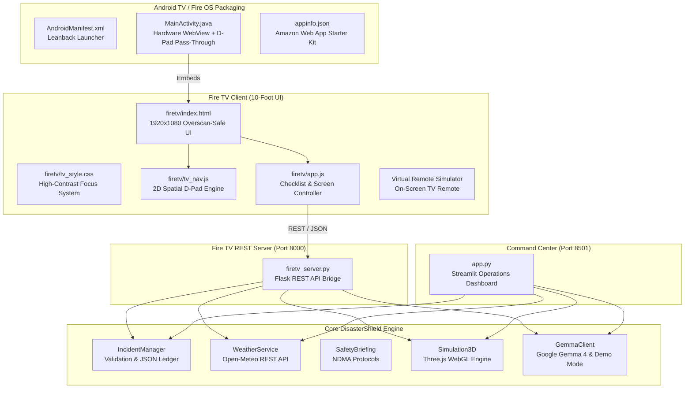

# 🛡️ DisasterShield AI
### Prepare Smarter. Respond Safer.

[](https://www.python.org/)
[](LICENSE)
[](firetv/)
[](https://streamlit.io/)
[](https://python-visualization.github.io/folium/)
[](https://threejs.org/)
[](https://ai.google.dev/gemma)
[](tests/)

---

## 📌 Project Overview

- **Project Name:** **DisasterShield AI**
- **Tagline:** Prepare Smarter. Respond Safer.
- **GitHub Repository (Fire TV Edition):** [https://github.com/Adarshyadav24-cyber/DisasterShield-AI-FireTV](https://github.com/Adarshyadav24-cyber/DisasterShield-AI-FireTV)
- **Deployment Platform:** Render (Web Service)
- **Live Streamlit Web App:** [https://disastershield-ai-adarshyadav.streamlit.app/](https://disastershield-ai-adarshyadav.streamlit.app/)
- **Fire TV Application:** `http://localhost:8000/` (Local) / Render Deployed URL

---

## ⚠️ Mandatory Public Safety Disclaimer

> **"DisasterShield AI is an informational prototype, not an official emergency dispatch or rescue service. Verify alerts and follow instructions from authorized local authorities, police, and district administration. Do not rely on this prototype alone for life-critical evacuation decisions."**
>
> - **National Emergency Helpline (India):** Dial **112** (All emergencies)
> - **State Disaster Control Room:** Dial **1077**
> - **Medical Ambulance:** Dial **108**
> - **Fire Service:** Dial **101**
> - **Demo Data Notice:** All demonstration incidents and 3D simulations are explicitly labeled as `DEMO DATA` / `DEMO SIMULATION`. No fictional hazards are represented as real ground events.

---

## 🛑 Problem Statement

During major natural hazards (monsoon flooding, urban fires, severe cyclones, and seismic tremors), households face a critical dual challenge:
1. **The Physical Threat:** Rising floodwaters, blocked roads, power outages, and collapsed utilities.
2. **The Information Crisis:** Confusing social media rumors, complex technical weather bulletins, inaccessible portals, and a lack of clear, household-level emergency preparation steps.

Most disaster websites are built for desktop computer mice or smartphone pinch-to-zoom gestures. During a home emergency, the **living room television** is often the primary central screen for the entire family. Yet existing disaster systems provide **no 10-foot television interface**, cannot be navigated using a simple Fire TV remote D-pad, and lack interactive household readiness checklists.

---

## 💡 Solution: How DisasterShield AI Solves This

**DisasterShield AI** introduces a dual-interface emergency intelligence ecosystem:
1. **Fire TV 10-Foot Application (`firetv/`):** A TV-first emergency hub designed for 1080p television displays viewed from 10 feet away. Features overscan-safe spacing, ultra-high contrast dark glassmorphism, complete remote control D-pad navigation, an interactive persistent household preparedness checklist, grounded plain-language AI safety guidance, official helpline access, and remote-controlled 3D simulation.
2. **Emergency Command Center (`app.py`):** A comprehensive operational desktop dashboard powered by Streamlit, Folium 2D mapping, Three.js 3D digital twins, citizen incident reporting, and an authenticated verification desk.

---

## 👥 Target Users & Use Cases

| User Group | Context & Need | DisasterShield AI Solution |
| :--- | :--- | :--- |
| **Households & Families** | Watching TV at home during an impending storm or flood warning | Uses Fire TV remote to check sector threat level, verify household checklist items, and review NDMA safety actions |
| **Elderly & Non-Technical Citizens** | Cannot navigate complex mobile apps or desktop browsers | Large high-contrast text, simple Up/Down/Left/Right/OK remote controls, and plain-language guidance |
| **Community Coordinators** | Ingesting and evaluating neighborhood ground reports | Reviews citizen submissions in the Administrator Verification Desk before public broadcast |
| **Emergency Managers** | Visualizing spatial flooding and seismic hazards | Explores interactive 3D procedural digital twin scenes and live meteorological telemetry |

---

## 🏗️ System Architecture



---

## 📱 Fire TV Experience: 10-Foot TV Design

The Fire TV application is engineered strictly to Amazon Fire TV design standards:
- **10-Foot Typography & Sizing:** Minimum 16px body text scaled up to 38px values; high-contrast white text on obsidian `#060b14` surfaces.
- **5% Overscan Safety Margins:** Content is positioned with `5vw` horizontal and `4vh` vertical padding to ensure no text is clipped on older TV panels.
- **Clear Focus Indicators:** Every focusable card, button, and tab highlights with a glowing cyan outline (`#38bdf8`), glow shadow, and `scale(1.03)` micro-animation.
- **Complete D-Pad Remote Navigation:** Full spatial navigation using TV Remote D-Pad (Up, Down, Left, Right), Select (Enter), and Back (`Escape` / `Backspace` / keyCodes `8`, `27`, `10009`, `461`).
- **No Mouse/Hover Dependencies:** Zero controls rely on mouse hovers or touch drag gestures.
- **Built-in Fire TV Remote Simulator:** For easy evaluation in any Windows browser, an on-screen Fire TV Remote controller is available on the bottom right (press `R` to toggle).

---

## 🛠️ Features Actually Implemented

### 1. Fire TV Household Preparedness Center
- **Interactive Supplies Checklist:** 10 essential supplies based on NDMA / Red Cross guidelines (Drinking Water, Non-Perishable Food, First Aid Kit, Flashlight, Emergency Radio, Power Bank, Waterproof Documents, Family Plan, Signal Whistle & Masks, Sanitation Kit).
- **Persistent Progress:** Checkbox states save locally in the TV browser via `localStorage` and persist across reboots. Real-time visual progress bar updates dynamically.

### 2. AI Safety Assistant (Google Gemma 4)
- **Remote-Friendly Quick Prompts:** TV remote clickable chips for flood evacuation, earthquake tremors, structural fire stairwell rules, storm precautions, and active sector situation briefings.
- **Strict Grounding:** Model responses are strictly grounded in active incident facts and official NDMA safety protocols. No hallucinated casualty numbers or fictional evacuation corridors.
- **Dual Mode (Live vs Demo):** Probes for active Google Gemma 4 server (`gemma4:e2b`). If offline, transparently activates deterministic rule-based templates clearly labeled with `DEMO MODE (RULE-BASED)`.

### 3. Hazard & Disaster Safety Guidance
- **Verified NDMA Protocols:** Curated guides for **Flood**, **Fire**, **Earthquake**, **Storm**, **Landslide**, and **General Emergency Preparedness**.
- **Clear DOs and DON'Ts:** Distinct high-contrast green checklist of mandatory actions and red warning boxes of critical hazards to avoid.

### 4. Tactical TV Map & Location Information
- **TV-Optimized Cartography:** Interactive Leaflet map centered on active demonstration city with color-coded incident markers (Red = Critical, Amber = Moderate, Green = Low/Facility).
- **Tactical POI Ledger:** D-pad focusable landmark and incident cards displaying coordinates, severity, and verification status.

### 5. Trusted Emergency Resources & Helplines
- **Direct Helpline Access:** Prominent cards for **112** (National Emergency), **1077** (State Disaster Control), **108** (Ambulance), and **101** (Fire Rescue).
- **Relief Facilities Catalog:** Real hospital bed counts, community flood shelters, civil defense depots, and NDRF rescue staging bases.

### 6. 3D Digital Twin Simulation (TV Mode)
- **Three.js WebGL Simulation:** Remote-controlled procedural 3D scenes for Flood water plane inundation, dynamic Fire particles, Earthquake harmonic tremors, and Storm rainfall.

### 7. Multi-City Tactical Sectors
- Instant sector switching between:
  - **Prayagraj, Uttar Pradesh** (Default — Ganga & Yamuna Sangam Basin)
  - **Lucknow, Uttar Pradesh** (Gomti River Basin Corridor)
  - **Varanasi, Uttar Pradesh** (Ancient Ganges Ghats & Riverfront)
  - **New Delhi, India** (Yamuna Floodplain Corridor)

### 8. Streamlit Operations Command Center (`app.py`)
- Full desktop operational suite with citizen report submission form, Folium mapping, and an enhanced PIN-protected Administrator Verification Desk with timing-safe comparison (`hmac.compare_digest`) and brute-force lockout throttling.

---

## ⏳ Planned / Incomplete Features

The following items are intentionally scoped for future production iterations:
- **GPS Hardware Location:** Currently uses documented approximate city coordinates; hardware GPS integration on TV depends on network provider geolocation.
- **Live Two-Way Emergency Dispatch:** Integration with municipal CAD (Computer-Aided Dispatch) requires government inter-agency clearance and authorized APIs.
- **Voice Remote / Alexa Skill Integration:** Voice commands via Amazon Alexa Voice Service (AVS) are planned for the next release.

---

## 🛠️ Technology Stack

| Component | Technology | Role |
| :--- | :--- | :--- |
| **TV Frontend** | **HTML5, Vanilla CSS3, JavaScript** | 10-foot TV UI, 2D spatial D-pad engine, and local storage |
| **TV Backend** | **Python 3.11, Flask 3.1** | Lightweight REST server delivering TV assets and API endpoints |
| **Desktop Dashboard** | **Streamlit (v1.64.0)** | Operations command center for incident intake and desktop analysis |
| **AI / LLM Engine** | **Google Gemma 4 (`gemma4:e2b`)** | Grounded situation summaries and safety protocol translation |
| **Local Inference Host** | **Ollama** | Local, zero-latency, privacy-preserving Gemma 4 inference |
| **3D Graphics** | **Three.js & WebGL** | Client-side 3D digital twin rendering (flood, fire, quake, storm) |
| **Geospatial Mapping** | **Leaflet.js & Folium** | TV map rendering and OpenStreetMap cartographic tile layers |
| **Weather Telemetry** | **Open-Meteo Public API** | Live, keyless meteorological data (temperature, wind, rain) |
| **Android TV Packaging** | **Android Leanback (Gradle)** | Native Fire OS / Android TV APK wrapper project |
| **Automated Testing** | **Pytest (v9.1.1)** | 25 automated unit tests covering validation, API, and 3D scenes |

---

## 🧠 AI Model Specification & Integration

- **Exact Model Name:** **Google Gemma 4** (specifically tested with `gemma4:e2b` via Ollama; compatible with standard Gemma 4 open weights).
- **Official Model Information:** [Google Gemma Open Models](https://ai.google.dev/gemma)
- **Model License & Terms:** [Gemma Terms of Use](https://ai.google.dev/gemma/terms) and [Gemma Open Model License](https://ai.google.dev/gemma/license).
- **Architectural Isolation:**
  - DisasterShield AI contains **zero** proprietary cloud generative AI API dependencies (no OpenAI, no Anthropic, no Gemini generative API keys).
  - All model calls originate through `modules/gemma_client.py` with strict safety rules:
    1. Grounded strictly in the active incident ledger and NDMA safety guidelines.
    2. Explicitly distinguishes verified official reports from unverified citizen submissions.
    3. Never claims an evacuation route is safe without ground verification.
- **Transparent Safe Demo Mode Fallback:**
  - If no local or remote Gemma 4 inference server is active, the app automatically switches to **Safe Demo Mode**.
  - Demo outputs use deterministic, rule-based templates and are **explicitly watermarked** as `DEMO MODE (RULE-BASED)`. They are never presented as live AI model responses.

---

## 💻 Installation & Running Locally (Windows)

### Prerequisites
- **Operating System:** Windows 10/11 (or macOS / Linux)
- **Python:** Python 3.11.x installed (`python --version`)
- **Git:** Installed for repository management

### 1. Clone the Repository
```powershell
git clone https://github.com/Adarshyadav24-cyber/DisasterShield-AI.git
cd DisasterShield-AI
```

### 2. Set Up Virtual Environment
```powershell
python -m venv .venv
.\.venv\Scripts\Activate.ps1
```

### 3. Install Dependencies
```powershell
pip install -r requirements.txt
```

### 4. Run the Automated Test Suite (Pytest)
```powershell
pytest -v
```
*(All 25 automated unit tests will execute and pass in ~25 seconds).*

### 5. Launch the Application

#### Option A: One-Click Launcher Menu (Recommended)
Run the batch launcher:
```powershell
.\run_app.bat
```
Select `[1]` for Fire TV Edition, `[2]` for Streamlit Command Center, or `[3]` for Tests.

#### Option B: Launch Fire TV Edition Directly (Port 8000)
```powershell
python firetv_server.py
```
Open your browser and navigate to: **`http://localhost:8000/`**

#### Option C: Launch Streamlit Operations Center (Port 8501)
```powershell
python -m streamlit run app.py
```
Open your browser and navigate to: **`http://localhost:8501/`**

---

## 📺 Fire TV & Android TV Packaging Instructions

DisasterShield AI supports two official packaging paths for Amazon Fire TV:

### Method 1: Fire TV Web App / Amazon Web App Starter Kit (WASK)
1. Deploy or host `firetv/` on a local or public HTTPS web server.
2. The `firetv/appinfo.json` and `firetv/manifest.webmanifest` files configure the Fire TV web runtime.
3. In the Amazon Developer Console, submit as an **Amazon Fire TV Web App** pointing to the hosted start URL.

### Method 2: Native Android TV / Fire OS Leanback APK (`android-firetv/`)
The repository includes a ready-to-build Android TV Leanback Gradle project:
```powershell
cd android-firetv
# Build debug APK with Gradle (requires Android SDK installed)
.\gradlew assembleDebug
```
The resulting APK can be installed on any physical Fire TV Stick or Android TV emulator:
```powershell
adb connect <FIRE_TV_IP_ADDRESS>:5555
adb install -r app\build\outputs\apk\debug\app-debug.apk
```

---

## 🧪 Testing Instructions & Honest Test Results

DisasterShield AI includes 25 automated unit tests in `tests/`:

```powershell
pytest tests/ -v
```

### Verified Test Summary:
- `tests/test_firetv_api.py` (7 tests): Validates healthcheck, status aggregation, sector switching, NDMA guidance categories, AI query safety, 3D simulation embed, and Fire TV web index delivery.
- `tests/test_gemma_client.py` (6 tests): Validates Gemma 4 connection probing, live generate requests, incident summarization, situation briefings, category suggestion, and transparent demo fallback.
- `tests/test_incidents.py` (9 tests): Validates citizen submission validation, coordinates checking, ID formatting, status updates, summary metrics, and JSON ledger persistence.
- `tests/test_simulation_3d.py` (3 tests): Validates HTML canvas generation, JavaScript asset loading, and scenario serialization.

**Actual Result:** **25 passed in 23.74s (100% Pass Rate).**

---

## 🔒 Security & Privacy Notes

1. **Zero Secret Leaks:** No API keys, cloud tokens, or personal identifiers are stored in code or repository commits.
2. **Administrator Verification Security:** PIN verification utilizes constant-time string comparison (`hmac.compare_digest`) and session state with attempt throttling (45-second lockout after 5 failed attempts) to prevent brute-force attacks.
3. **Transparent Demo Notices:** All test incidents and simulations are explicitly flagged as demo data.

---

## 📁 Project Folder Structure

```
DisasterShield-AI/
├── .env.example                # Safe environment variable template with placeholders
├── .gitignore                  # Git hygiene exclusions (caches, .env, venvs)
├── LICENSE                     # Apache 2.0 Open Source License
├── Procfile                    # Deployment process configuration
├── README.md                   # Complete hackathon documentation
├── HACKATHON_CHANGES.md        # Record of hackathon additions vs pre-existing code
├── app.py                      # Streamlit Operations Command Center (Port 8501)
├── config.py                   # Central configuration, demonstration cities & coordinates
├── firetv_server.py            # Fire TV Flask REST Server & Static Host (Port 8000)
├── requirements.txt            # Python dependencies (Streamlit, Flask, Folium, Pytest)
├── run_app.bat                 # Interactive Windows multi-target launcher script
├── run_firetv.bat              # One-click launcher for Fire TV Edition
│
├── firetv/                     # Fire TV 10-Foot Client Application
│   ├── index.html              # 10-foot TV user interface (8 screens, 1080p, overscan-safe)
│   ├── tv_style.css            # TV design system, cyan glow focus states, high contrast
│   ├── tv_nav.js               # 2D spatial navigation engine & virtual remote controller
│   ├── app.js                  # TV screen controller, checklist persistence, AI queries
│   ├── manifest.webmanifest    # W3C Web App Manifest for Fire TV / Android TV
│   ├── appinfo.json            # Amazon Web App Starter Kit configuration
│   └── icon-512.png            # 512x512 application icon asset
│
├── android-firetv/             # Native Fire OS / Android TV Leanback Wrapper
│   ├── build.gradle            # Root Gradle build script
│   ├── settings.gradle         # Gradle project configuration
│   └── app/
│       ├── build.gradle        # App Gradle script targeting SDK 34 with Leanback
│       └── src/main/
│           ├── AndroidManifest.xml # Declares Leanback Launcher & permissions
│           └── java/com/disastershield/firetv/
│               └── MainActivity.java # Hardware-accelerated WebView with D-pad pass-through
│
├── modules/                    # Reusable Core DisasterShield Services
│   ├── gemma_client.py         # Google Gemma 4 client with transparent demo fallback
│   ├── incident_manager.py     # Incident reporting, validation & JSON ledger
│   ├── map_view.py             # Folium 2D geospatial map builder
│   ├── safety_briefing.py      # Standard NDMA public safety protocols
│   ├── simulation_3d.py        # WebGL Three.js procedural 3D digital twin generator
│   ├── weather_service.py      # Open-Meteo public meteorological telemetry service
│   └── static/                 # Embedded 3D libraries (Three.js, OrbitControls)
│
├── data/                       # Local Demonstration & Persistence Data
│   ├── demo_incidents.json     # Curated initial demonstration incident ledger
│   └── demo_resources.json     # Registered emergency facilities and shelters
│
└── tests/                      # Automated Quality Assurance Suite (Pytest)
    ├── test_firetv_api.py      # 7 unit tests for Fire TV server and REST endpoints
    ├── test_gemma_client.py    # 6 unit tests for Gemma 4 & demo fallback
    ├── test_incidents.py       # 9 unit tests for incident validation & persistence
    └── test_simulation_3d.py   # 3 unit tests for 3D simulation canvas generation
```

---

## 📜 License & Acknowledgements

This project is licensed under the **Apache License 2.0** — see the [LICENSE](LICENSE) file for full details.

- **National Disaster Management Authority (NDMA):** Public safety protocol references.
- **Open-Meteo:** Public meteorological data API.
- **OpenStreetMap & Leaflet:** Cartographic tiles and open-source map visualization.
- **Google Gemma Team:** Google Gemma 4 open model architecture and weights.
- **Amazon Developer Team:** Amazon Fire TV Track guidelines and 10-foot design specifications.
